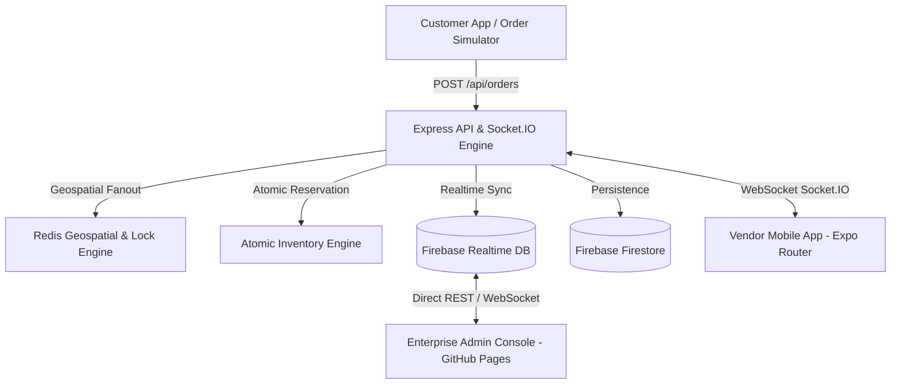

# 🛍️ GlowVAI Vendor App — Master Overview & System Architecture

## 📋 Executive Summary
The **GlowVAI Vendor App** is a high-concurrency, real-time dark store operator platform designed for beauty, skincare, wellness, and quick-commerce fulfillment (Blinkit / Zepto / Swiggy Instamart grade).

It powers instantaneous order fulfillment, atomic stock reservations, multi-vendor management, real-time driver/store geospatial dispatch, and direct Firebase database synchronization.

---

## 🏗️ High-Level System Architecture



---

## 🛠️ Technology Stack

| Layer | Technology / Framework | Purpose |
| :--- | :--- | :--- |
| **Backend API** | Node.js, Express.js | Core REST API server, authentication, earnings calculation, and rate limiting |
| **Realtime Engine** | Socket.IO | Bi-directional push ospatial Engine | Rapido/Swiggy-style nearest dark store candidate fanout & SETNX distributed locks |
| **Database & Cloud** | Firebase Admin SDK (Firestore & Realtime DB) | Multi-vendor data sync, live stock steppers, and persistent cloud storage |
| **Mobile App** | React Native, Expo (SDK 51), Expo Router | Cross-platform mobile app for dark store pickers and operators |
| **State Management** | Zustand (`useVendorStore`) | Reactive global state, order lifecycle management, stock state, and local storage |
| **Admin Portal** | HTML5, Vanilla CSS3, JavaScript (ES6+) | Lightweight, standalone admin console hostable on GitHub notifications, live order offer popups, duty state changes |
| **Geospatial & Locking** | Redis / In-Memory GePages |

---

## ⚡ Core Operational Capabilities

1. **Instant Order Push & Sound Alerts**: Incoming orders trigger loud sound alerts and high-priority full-screen modal offers on the vendor app within milliseconds.
2. **Race-Condition Safe Order Acceptance**: Distributed locking ensures that when an order is offered to multiple nearby stores, only the first store to accept acquires the lock. All other stores are instantly notified with an `ORDER_CLAIMED_BY_OTHER` dismissal.
3. **Atomic Stock Reservations**: Prevents overselling by immediately reserving stock (`reservedStock`) upon order placement, adjusting `availableStock` on the fly.
4. **Order Lifecycle Workflow**:
   - `PENDING` → Dispatched to nearby dark stores
   - `ACCEPTED` → Store accepts offer and starts picking
   - `PACKED` → Picker verifies items by bin location (`BIN-A-01-02-01`)
   - `READY` → Package handoff ready for delivery rider
   - `DISPATCHED` → Rider on the way
   - `DELIVERED` → Payout credited to vendor ledger
5. **Real-time Catalog & Bin Matrix**: Vendor operators can search SKUs, view aisle/bin locations, toggle item availability, and adjust stock quantities in real time.
6. **Financial Payout Ledger**: Automatic split: **88% Vendor Net Payout** vs **12% Platform Take-Rate**.

---

## 📂 Repository Structure

```
glowvai-vendor-app/
├── backend/                  # Node.js Express & Socket.IO backend
│   ├── src/
│   │   ├── server.js         # Main server entrypoint & REST routes
│   │   └── services/
│   │       └── redisDispatch.js # Geospatial fanout & SETNX locking engine
│   ├── package.json
│   └── .env
├── mobile/                   # React Native Expo Router vendor app
│   ├── app/                  # Expo Router file-based screens
│   │   ├── (tabs)/           # Main navigation tabs (Dashboard, Orders, Inventory, Earnings, Profile)
│   │   ├── order/[id].tsx    # Order picking & dispatch workspace
│   │   ├── product/[id].tsx  # Product details & stock adjustment
│   │   ├── add-product.tsx   # Add new SKU form
│   │   └── notifications.tsx # Push notification history
│   ├── src/                  # API, Socket.IO, Zustand stores, components
│   └── package.json
└── docs/                     # Documentation suite & Admin Console
    ├── index.html            # Enterprise Multi-Vendor Admin Console
    ├── README.md             # Master documentation index
    └── 00_MASTER_OVERVIEW_AND_ARCHITECTURE.md (and 01-09 modular guides)
```
