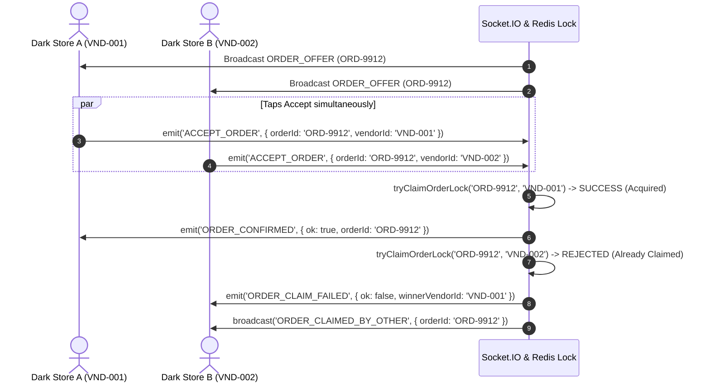

# 📡 Real-Time Socket.IO & Geospatial Dispatch Engine

## 🛰️ Architecture Overview
The dispatch subsystem (`backend/src/services/redisDispatch.js`) implements a high-concurrency order dispatch flow modeled after **Rapido**, **Swiggy Instamart**, and **Uber**.

When a customer places an order, the engine calculates nearby dark stores within a configurable geospatial radius (e.g. 6-8 km) and fans out the order offer to candidate store operators simultaneously.

---

## 🗺️ 1. Geospatial Candidate Search (Haversine & Redis GEO)

The dispatch engine maintains a registry of active vendors with their real-time GPS coordinates (`latitude`, `longitude`).

```js
// Calculates Haversine distance in kilometers between store and order location
haversineDistanceKm(lat1, lon1, lat2, lon2)
```

1. **Filtering**: Selects vendors where `isOnline === true`.
2. **Radius Boundary**: Filters candidates within a defined radius (default: 8 km).
3. **Sorting**: Sorts candidates in ascending order by distance (closest dark store first).
4. **Candidate Limit**: Picks the top 6 nearest dark store candidates for simultaneous broadcast.

---

## ⚡ 2. Rapido-Style Race Condition Handling & SETNX Locking

When an order offer is dispatched to multiple nearby dark stores, multiple pickers may tap **"Accept Order"** at the exact same millisecond. To guarantee that an order is never assigned to two stores, the backend utilizes an **Atomic SETNX (Set-If-Not-Exists) Distributed Lock**.



### Distributed Lock Implementation Logic:
```js
async tryClaimOrderLock(orderId, vendorId, ttlMs = 30000) {
  const now = Date.now();
  const existingLock = this.activeLocks.get(orderId);

  // Reject attempt if lock is active
  if (existingLock && existingLock.expiresAt > now) {
    return { success: false, winnerId: existingLock.vendorId };
  }

  // Atomically grant lock
  this.activeLocks.set(orderId, {
    vendorId,
    acquiredAt: now,
    expiresAt: now + ttlMs,
  });

  return { success: true, winnerId: vendorId };
}
```

---

## 📡 3. Complete Socket.IO Event Reference

### Client → Server Events

| Event Name | Payload Structure | Description |
| :--- | :--- | :--- |
| `vendor:register` | `{ vendorId, storeId, lat, lng, name }` | Registers socket connection into `vendor:<vendorId>` and `store:<storeId>` rooms |
| `vendor:location:update` | `{ vendorId, latitude, longitude }` | Sends live GPS updates for mobile vendor units |
| `vendor:setStatus` | `{ vendorId, isOnline: boolean }` | Toggles vendor online/duty availability status |
| `ACCEPT_ORDER` | `{ orderId, vendorId }` | Triggers atomic lock acquisition attempt to accept order |
| `DECLINE_ORDER` | `{ orderId, vendorId }` | Expresses decline, dismissing order card from current vendor |

### Server → Client Events

| Event Name | Payload Structure | Description |
| :--- | :--- | :--- |
| `vendor:registered` | `{ ok: true, vendorId, storeId }` | Confirms successful socket channel registration |
| `ORDER_OFFER` | `{ event, order, sentAt }` | Dispatches new order offer card with 45s countdown timer |
| `ORDER_CONFIRMED` | `{ ok: true, orderId, vendorId, order }` | Confirms successful order reservation to the winning vendor |
| `ORDER_CLAIM_FAILED` | `{ ok: false, orderId, winnerVendorId }` | Notifies losing vendor that order was claimed by another store |
| `ORDER_CLAIMED_BY_OTHER` | `{ orderId, winnerVendorId }` | Emits screen clear signal to dismiss offer modal on losing devices |
| `inventory:stockUpdated` | `{ productId, availableStock, reservedStock }` | Broadcasts real-time catalog stock level updates |
